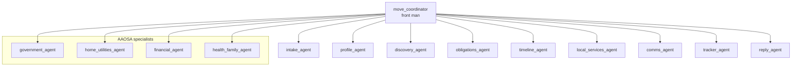

<!-- pyml disable line-length-->
# House Move Agent

A multi-agent assistant, built on [Neuro SAN Studio](https://github.com/cognizant-ai-lab/neuro-san-studio), that helps someone moving home in the UK tell
every organization that needs to know, in the right order and on time, without sending anything they have not
approved.

> EMEA Hackathon 2026 entry by associate 110737 (Varadaraj.pandurangan@cognizant.com, BFS UK).
>
> Hackathon build. Synthetic customer data only. Every send is mocked and logged; nothing leaves the machine.
>
> Code and these docs use US spelling; text the UK customer sees (the app, letters and agent prompts) uses UK
> spelling.

## Contents

- [The problem](#the-problem)
- [What it does](#what-it-does)
- [Design principle: AI only where it adds value](#design-principle-ai-only-where-it-adds-value)
- [Agent network](#agent-network)
- [Data, privacy and safety](#data-privacy-and-safety)
- [Getting started](#getting-started)
- [Running the demo](#running-the-demo)
- [Test customers](#test-customers)
- [Project layout](#project-layout)
- [Tests](#tests)
- [Data sources](#data-sources)
- [Known limitations](#known-limitations)
- [License and credits](#license-and-credits)
- [Roadmap](#roadmap)

## The problem

Moving home in the UK means telling 15 to 30 organizations. Some are legal requirements: DVLA (fines of up to
£1,000), council tax (a £70 penalty for not notifying), the electoral register, TV Licensing. Others cost money if
missed: energy and water final readings, insurance that no longer matches the address. People forget some, find
out late, and then contact their bank and providers to fix the gaps.

## What it does

1. **Discovers** who the customer pays from their own transactions, including the ones they forgot
   (for example: "you pay for pet insurance, so you need to update your pet's microchip"), and every mortgage,
   credit card or loan lender they repay, each with its own address-change task.
2. **Plans** a dated task list against the completion date, from rules with official sources, using UK working
   days and the bank holidays of the country they are moving to.
3. **Drafts** every notification with placeholders, so personal data is filled in by code, not by the LLM.
4. **Gets approval** for each draft: the customer reads and approves it on their signed-in portal page, or confirms
   in the chat with a one-time code they type themselves, so the LLM cannot approve on their behalf.
   Legal-requirement drafts must be approved one by one.
5. **Tracks** progress: mock sends, the bank's own address update, replanning when completion moves, and provider
   replies (for example a request for a meter serial number).
6. **Finds local contacts** at the new address: nearest GP practices (NHS, live), schools for the children's ages
   (Department for Education data) and the water and sewerage companies.

Two ways in:

| Route | Who | How the data arrives |
|---|---|---|
| **Bank customer** (`C-…`) | A mortgage customer whose completion date has been set | Profile from the CRM, 90 days of transactions and Direct Debit references from the bank (mocked) |
| **Standalone** (`S-…`) | Anyone moving, bank customer or not | A short chat, a statement uploaded on a separate secure page (CSV, OFX or QFX) or a list of providers, and personal details from the app's form, stored encrypted in SQLite |

Cross-border moves are handled: Scotland (water billed with council tax), Wales, and Northern Ireland (domestic
rates through Land & Property Services instead of council tax, and an NI driving license route).

## Design principle: AI only where it adds value

| Deterministic (code and rules) | AI (LLM agents) |
|---|---|
| Which obligations apply, from known facts (24 rules with source URLs) | Turning messy descriptors (`BRIGHTWATT EN DD 0034X`) into providers and life facts |
| Deadlines in working days, bank holidays per nation | Conversational intake: free text into structured facts |
| Legal flags and penalties, copied from the rules file | Edge cases the rules do not cover (letting the old home, joint owners) |
| The approval gate: nothing is sent unless its status is `approved` | Personalizing each draft to the organization |
| What a date change means for each task (correction, rebooking, automatic) | Reading a provider's reply and deciding the next step |
| Audit log, case store, encryption, statement parsing | Explaining the plan in plain English |

An LLM never invents a deadline, fee or legal obligation: those come only from
[`obligations_rules.json`](../../../coded_tools/hackathon/house_move/data/obligations_rules.json). If the rules do not cover
a situation, the agents say so and point to gov.uk.

## Agent network

Network file: [`registries/hackathon/house_move.hocon`](../../../registries/hackathon/house_move.hocon), runtime name
`hackathon/house_move`. 14 LLM agents and 27 coded tools.



| Agent | Job | Main tools |
|---|---|---|
| `move_coordinator` | Owns the conversation: intake → discover → plan → draft → approve → track | All agents below |
| `intake_agent` | Starts a standalone case, imports a statement or listed providers, deletes a case | `create_case`, `import_statement`, `add_manual_providers`, `delete_case` |
| `profile_agent` | What is known, what is missing, the questions to ask; resumes a saved case | `customer_profile_lookup` |
| `discovery_agent` | **AI moment 1:** providers and life facts from transactions | `get_transactions` |
| `obligations_agent` | Which organizations must be told; councils for both postcodes (live) | `council_lookup`, `obligations_rules` |
| `timeline_agent` | Dated plan grouped by week | `build_timeline` |
| `local_services_agent` | GPs, schools and water companies at the new address | `gp_finder`, `school_finder`, `water_supplier_lookup` |
| `government_agent` and 3 other specialists | AAOSA: each says whether a task is theirs (Determine), then records how to do it (Fulfill) | `list_tasks`, `update_tasks`, directories |
| `comms_agent` | One draft per task, with `{{placeholders}}` | `letter_templates`, `save_drafts` |
| `tracker_agent` | **AI moment 2:** approval codes, send, replan corrections, audit | `request_approval`, `confirm_with_code`, `send_notification`, `bank_address_api`, `plan_corrections`, `get_audit_log` |
| `reply_agent` | Reads provider replies and records what they say; has no approve or send tools | `check_inbox`, `record_reply` |

## Data, privacy and safety

- **The server holds the state; the client holds a signed session.** Every stateful tool runs inside a session
  (`case_session.py`, `case_tool.py`): it verifies an HMAC-signed session token, discards any case data the client
  sent, reloads the real state from the case store, runs, and saves it back. Only `session_token` is on the
  `allow.to_upstream` list, so profiles, Direct Debit references, drafts and the outbox never go back to the client.
- **You can open only your own case.** The token says who you are. A bank customer's token lists the records they
  may open; a standalone case opens only for the person who created it. Standalone case IDs carry 128 random bits.
- **Personal data stays out of the LLM.** Full names, street addresses, email and account references stay on the
  server. The LLM sees first names, towns and postcodes, and writes drafts with placeholders such as
  `{{new_address}}` that code fills in at send time.
- **Personal details come only from the portal.** A guest types their full names, street addresses and email on
  the portal's "Your details" page (`/details`), checked field by field (`PersonalDetails`) and stored encrypted;
  `create_case` moves them into the new case's vault. Anything sent through the chat client is discarded. A detail
  that is missing or blank is a gap, never "filled": the letter goes to the customer to complete, not to the
  organization.
- **Encrypted at rest, keys kept apart** (`case_data/`, git-ignored, folder `0700`, database `0600`): each case's
  plan state is one Fernet-encrypted blob per owner; personal details are encrypted per field; statement rows are
  encrypted per statement. The plan keeps drafts with their placeholders and only a fingerprint of what was sent,
  never the filled-in letters. The vault key and session secret live in `~/.house_move/keys` (or
  `HOUSE_MOVE_KEY_DIR`, or environment variables), not next to the data. SQLite's secure delete overwrites erased
  data. Cases can be deleted on request and purged after the move.
- **Statements never go through the chat.** nsflow's paperclip pastes file text into the message, so the agents
  refuse pasted statements and send users to the portal. Uploads go to the signed-in person's own folder, can be
  imported only into a case that person owns, are deleted after reading, and are deleted after a day if never
  imported. Every portal form post must come from the portal itself (Origin and Sec-Fetch-Site checks on top of
  the strict-SameSite cookie).
- **Replies are tied to what was really sent.** The mock inbox's scripted replies are for the demo customer only,
  must come from the task's own provider, and arrive only for letters that reached the organization; a pack the
  customer still has to send shows as "Ready for you to send", not "Sent".
- **Consent the LLM cannot fake:** approvals, statement imports and deletions issue a one-time 6-digit code (valid
  30 minutes, usable once). `CustomerMessageMiddleware` records what the customer actually types, server-side, and
  `confirm_with_code` acts only if that message arrived after the code and contains it. The customer's own message
  is what gets stored as consent.
- **Approving and sending in the app:** "Send them now" sends only letters already approved, through the same
  `send_notification` gate as the agents, from the customer's own signed-in browser (no LLM decides).
- **Approving on the portal:** the review sheet opens each draft and approves the exact wording shown
  (`ApproveOnPortal`). The click comes from the customer's own signed-in browser, so no LLM is involved; the request
  must be same-origin JSON with the strict-SameSite session cookie. It takes the same per-owner lock as the agents,
  which is also a file lock, so the portal and the agent server never overwrite each other's changes.
- **Approval gate in code:** each approval is tied to the draft's exact wording. `send_notification` and
  `bank_address_api` refuse anything without a confirmed approval for the current wording; any approved task that
  cannot go out is reported, never dropped silently. "Approve all" leaves out legal-requirement drafts.
- **Audit trail:** approvals, sends, direct updates, replans, replies and deletions are appended to
  `logs/house_move_audit.jsonl` with IDs and events only.

### Review status

Three reviews found thirteen issues: four security issues, four ways the plan could silently go wrong, and five gaps
in the standalone journey and data protection. Status:

| Finding | Status |
|---|---|
| Client could send back forged state (for example tasks marked approved) | **Fixed:** server-side state, signed sessions; regression tests replay the attack |
| Anyone could open any case by typing its ID; decrypted personal data went back to the client | **Fixed:** ownership checks, unguessable IDs, only the token goes upstream; regression tests |
| "Consent" is text the LLM writes (`customer_words`), so it is not proof of what the customer said | **Fixed:** one-time codes checked against the customer's own message, captured by middleware; regression tests |
| The agent that reads provider replies can also approve and send (prompt-injection risk) | **Fixed:** `reply_agent` reads replies and can only record them; reply text is labeled untrusted; `record_reply` acts only on a real reply's own, already-sent task; approvals need the customer's own code; regression tests |
| Changing a fact grafted one task's progress onto another (task IDs were list positions) | **Fixed:** a task's ID comes from its rule's place in the rules file; progress is carried over by obligation, never by ID; existing plans keep their IDs; a dropped task that was already sent is reported; regression tests |
| Home insurance was dated from completion when exchange was unknown, after the customer is liable | **Fixed:** with no exchange date it is dated today, with a warning, and dated on exchange once known; regression tests |
| Dates were not checked (exchange after completion, a move date years in the past) | **Fixed:** one shared check for case creation and the timeline: exchange on or before completion and within a year of it; completion no more than 30 days past (someone who has just moved still has tasks) or two years ahead; regression tests |
| Moving within one council created two council tax tasks | **Fixed:** a move within one council is one council tax task; regression tests |
| The "secure form" for personal details did not exist, so standalone vaults were empty | **Fixed:** the portal's "Your details" page, checked field by field and stored encrypted until the case is created; details sent through the chat client are discarded; regression tests |
| A blank detail counted as filled, so a letter with no name, street or email went to the organization | **Fixed:** missing or blank details, and an address without a street, are gaps, so the letter goes to the customer to complete; regression tests |
| Uploads: shared, no CSRF protection, never-imported files kept | **Partly already fixed, now complete:** uploads were already per signed-in person and importable only into their own case; every form post now refuses other sites; uploads never imported are deleted after a day; regression tests |
| Provider replies were canned for everyone, and could confirm a task that never reached the organization | **Fixed:** scripted replies are for the demo customer only, must come from the task's own provider, and only follow letters that reached the organization; customer packs show as "Ready for you to send"; regression tests |
| Encryption at rest was mostly for show (key beside the data, plain transactions, filled-in letters in the plan) | **Fixed:** keys in a separate owner-only folder (existing keys moved there), owner-only database, encrypted statement rows (old rows encrypted on open), no filled-in letters stored, secure delete; regression tests |

## Getting started

Requirements: macOS or Linux, git, [uv](https://docs.astral.sh/uv/), an Anthropic API key.

```bash
git clone https://github.com/varadarajp/neuro-san-house-move.git
cd neuro-san-house-move
uv venv venv --python 3.12
VIRTUAL_ENV=$PWD/venv uv pip install -r requirements.txt -r requirements-build.txt
VIRTUAL_ENV=$PWD/venv uv pip install -r coded_tools/hackathon/house_move/requirements.txt
```

The network has optional dependencies, so it is disabled in `registries/hackathon/manifest.hocon`.
[`registries/house_move_demo_manifest.hocon`](../../../registries/house_move_demo_manifest.hocon) switches it on.
Put your key and the manifest list in `.env` (git-ignored):

```text
ANTHROPIC_API_KEY="sk-ant-..."
AGENT_MANIFEST_FILE=registries/manifest.hocon:registries/house_move_demo_manifest.hocon
```

The default LLM config falls back to Claude when no OpenAI key is set. Check it with
`venv/bin/python -m neuro_san_studio check-llm-keys`.

All commands below run from the repository folder. Start the server and the nsflow UI (server on port 8080,
UI on <http://localhost:4173>):

```bash
venv/bin/python -m neuro_san_studio run
```

Start the House Move portal (<http://127.0.0.1:8090>): sign-in, "Your details", statement upload and the "My move" page
(`/status`: stage, what is waiting for approval, tasks and recent activity, and Read and approve for each draft;
own case only). Every journey needs it:

```bash
venv/bin/python -m apps.house_move_upload.upload_server
```

Optional: refresh the schools list from the Department for Education (about 60 MB download):

```bash
venv/bin/python -m build_scripts.build_house_move_schools
```

Python code changes need a server restart; HOCON changes are picked up automatically.

## Running the demo

Everything happens in the House Move app at <http://127.0.0.1:8090>, laid out like a phone app. It always takes you
to where your input is needed: after sign-in, and after every task, it works out the next step from the real case
state and goes there. There are three tabs:

| Tab | What it is |
|---|---|
| **Move** | Progress, the one next step as a big button, your plan by date, and recent activity |
| **Chat** | The assistant. Your sign-in is attached on the server, and under each reply a card offers the next step |
| **Account** | Who is signed in, your details, statements, the nsflow session and sign-out |

Tasks open where you are, as sheets: **Review** (one letter at a time, Approve and next, then "Send them now"),
**Upload** (a statement, then the assistant is told), and **Reply** (answer what a provider asked for). A new guest
starts on **Start your move**: names, email, both full addresses and the move date, stored encrypted and never typed in
the chat; saving it starts the case and carries straight on in the chat.

nsflow (<http://localhost:4173>, **hackathon → house_move**) shows the agent network working. To chat there instead
of the Chat tab, open "Chatting in nsflow instead?" on Home, copy the session, paste it into nsflow's SlyData tab
(replacing anything there) and tick "Use Edited Sly Data".

To start every test customer from scratch (no plans, cases, codes, uploads or audit entries), reset the demo data.
It is moved to `case_data/backups/` first, so a reset can be undone:

```bash
venv/bin/python -m build_scripts.reset_house_move_demo --yes
```

To start just one demo customer again (for example Priya Shah, C-20001), leaving the others as they are:

```bash
venv/bin/python -m build_scripts.reset_house_move_demo --customer C-20001 --yes
```

**First, sign in** on the app and choose a demo bank customer (for example C-10042) or "I'm not a customer
(guest)". The demo sign-in stands in for the bank's own login: it opens only that customer's record, or only the
cases a guest creates. A bank customer's sign-in cannot start a separate move for someone else; sign in as a guest
for that. The app then takes you to each step in turn.

**Bank customer (about 5 minutes), in the Chat tab:**

1. On Move, press **Start in the chat** (or say "I'm moving house"). The sign-in says who you are, so the assistant
   looks up your record without asking for your customer ID; the ID is shown in the app bar if you need it.
   Discovery finds 12 providers, including pet insurance, and infers a pet and a young child.
2. Answer the questions and say "build the plan". Councils come from postcodes.io live; the plan is dated by
   week with legal items marked, followed by local GPs and water companies.
3. "Yes please, prepare the drafts." Four AAOSA specialists and Comms produce a draft per task.
4. "Approve all of them." The agent lists what will be approved, names the legal-requirement drafts that must be
   approved one by one, and shows a 6-digit code. Reply with the code (and name any legal drafts first). Or press
   **Review now** on the card and approve one letter at a time, then **Send them now**. Emails
   with known references then go to providers; the rest become pre-filled packs; the bank's own address update
   is made directly.
5. "Completion has moved to 11 December." The Tracker sorts every task: needs correction, needs rebooking,
   updated automatically, unchanged.
6. "Has anyone replied yet?" Brightwatt asks for a meter serial number; the agent drafts the follow-up.
7. "Show me the audit trail."

**Standalone:**

1. Sign in as "I'm not a customer (guest)". The app opens **Start your move**: enter the synthetic details Jordan
   Lee, jordan.lee@example.com; current home 8 Cotham Vale, Bristol, BS6 6RB (sold); new home 21 Lenton Boulevard,
   Nottingham, NG7 2NF; move date 11 December 2026. Saving starts the case and shows your case reference and a
   resume code, once: keep both. **Continue to the chat** carries on without asking again.
2. Press **Upload a statement** on the card and choose
   `coded_tools/hackathon/house_move/data/sample_statements/jordan_lee_bristol.csv`. The assistant is told and shows
   a code; reply with it to let the statement be read.
3. Continue as above. Later, with the same sign-in, the app picks up wherever you left off. After signing out,
   choose **Continue my move** on the sign-in screen and enter the case reference and resume code to get back to
   the same move. Five wrong codes lock the code; while signed in, **Account** makes a new one (the old one stops
   working). Only a salted hash of the code is stored.

The same journeys run from the command line, passing the session from Home's "Chatting in nsflow instead?":

```bash
venv/bin/python -m neuro_san.client.agent_cli --agent hackathon/house_move --http --port 8080 --sly_data '{"session_token": "v1...."}'
```

## Test customers

All synthetic. Postcodes are real and were checked on postcodes.io; people, street addresses and most providers
are fictional.

| ID | Move | What it exercises |
|---|---|---|
| C-10042 Sam and Alex Morgan | Leeds LS1 3ED → Harrogate HG1 1SY | The main demo: pet insurance discovery, nursery, car, a credit card and an old mortgage lender, date slip, replies |
| C-20001 Priya Shah | Halifax HX1 5LZ → Chelmsford CM1 1FR | England to England, different councils and water companies, no car |
| C-20002 Callum and Morag Reid | Glasgow G12 8QQ → Darlington DL3 9LP | Scotland to England: no old water account; completion on a Scottish-only bank holiday |
| C-20003 Rhys Evans | Cardiff CF24 3PY → Edinburgh EH7 4LB | Wales to Scotland: close the Welsh water account; water billed with council tax; no TV license |
| C-20004 Aoife and Daniel Byrne | Belfast BT9 5AH → Leeds LS6 3BQ | Northern Ireland to England: LPS rates, NI license route, a baby (schools and childcare) |
| Standalone: Jordan Lee | Bristol BS6 6RB → Nottingham NG7 2NF | Statement upload (CSV and OFX samples), case store, resume |

## Project layout

House Move files (everything else is Neuro SAN Studio):

```text
registries/hackathon/house_move.hocon         the agent network
registries/hackathon/manifest.hocon           lists the network, disabled by default
registries/house_move_demo_manifest.hocon     enables the network for the demo
coded_tools/hackathon/house_move/             coded tools (one class per file)
coded_tools/hackathon/house_move/data/        rules, synthetic data, directories, schools extract, samples
apps/house_move_upload/upload_server.py       the app: sign-in, routing, Move, Chat, Account, start form
apps/house_move_upload/journey_checklist.py   the journey and the one next step, from the case state
apps/house_move_upload/app.js                 sheets (review, upload, reply) and next-step actions
apps/house_move_upload/chat_relay.py          Chat tab relay to the agent network (session attached server-side)
build_scripts/build_house_move_schools.py     builds the schools extract from GIAS
tests/coded_tools/hackathon/house_move/       unit tests
tests/apps/house_move_upload/                 portal tests
tests/fixtures/hackathon/house_move/          integration fixtures (tests/integration/test_house_move_hocons.py)
House_Move_Agent.pptx                         pitch deck
```

## Tests

```bash
venv/bin/python -m pytest tests/coded_tools/hackathon tests/apps/house_move_upload -q
```

136 tests cover the rules engine (including Scotland, Wales and Northern Ireland), working-day dates, the approval
gate, mock sending, replanning, replies, the case store and encryption, statement parsing, the portal, and the GP,
school and water finders. `test_session_security.py` replays the review's attacks through the real session path:
forged approved state, opening another customer's record, missing or tampered tokens, guessing case IDs, reading
another person's upload, and parallel tool calls. `test_confirmation_codes.py` shows the LLM cannot confirm for the
customer: no message, wrong, expired or reused codes, codes seen only in tool or AI text, and drafts changed after
approval are all refused. `test_reply_isolation.py` checks that no agent that reads provider replies can approve or send, and that an injected reply changes nothing. `test_plan_integrity.py` and `test_data_protection.py` replay the second and third reviews' findings. `test_approve_on_portal.py` checks that a portal approval covers only the
wording the customer opened, only their own case, legal drafts one at a time, and that the owner's lock holds across
processes. Network calls are mocked in tests.

Integration fixtures in `tests/fixtures/hackathon/house_move/` run the network against the LLM. An API key is
needed. Each run uses temporary keys, and each fixture gets its own empty case database.

```bash
venv/bin/python -m pytest tests/integration/test_house_move_hocons.py -m integration -v
```

- Smoke tests: sign-in required, a guest sent to the start form, a guest whose case started on the form is given
  their case reference, and a bank customer's discovery.
- Discovery accuracy (`discovery_c_*.hocon`): one fixture per bank customer checks that "I'm moving house" finds
  their providers (by keyword) and the life facts their payments imply (by `gist`).
- Plan quality (`plan_c_20004.hocon`, and turn 2 of `plan_and_drafts_c_10042.hocon`): the plan marks exactly the
  rules' legal requirements as legal, finds the right councils, and quotes no fine or penalty other than the rules'.
- Draft quality (turn 3 of `plan_and_drafts_c_10042.hocon`): drafts are shown with `{{placeholders}}`, state no date
  other than a placeholder or the move dates, and no fee or penalty. Street addresses, email and the Direct Debit
  reference never appear in the chat.

A `gist` check asks an LLM judge whether the reply meets a plain-English criterion. The judge is
`tests/fixtures/hackathon/house_move/gist_judge.hocon`: it uses the project's LLM config, so any provider key works
(neuro-san's stock judge needs an OpenAI key).

The ground truth comes from the synthetic data in `coded_tools/hackathon/house_move/data/` (transactions and
obligation rules), and each fixture's header comment lists it in full.

| Customer | Providers discovery must find | Life facts it must infer |
|---|---|---|
| C-10042 | Brightwatt Energy, NVW Water Services, Fibrely Broadband, Voxmobile, TV Licensing, DVLA, Shieldmotor, Hearthguard, Pawsure, Little Acorns Nursery, Northway Building Society (mortgage), Amberline Card Services (credit card) | Pet, young child, car |
| C-20001 | Northgate Energy, Pennine Water, Lumen Fibre, Talkmore Mobile, TV Licensing, Hearthguard, council tax (Calderdale) | No pet, child or car |
| C-20002 | Brightwatt Energy, Fibrely Broadband, Clyde Home Cover, TV Licensing, DVLA, Shieldmotor, Pawsure, council tax (Glasgow) | Pet, child, car |
| C-20003 | Northgate Energy, Taff Valley Water, Lumen Fibre, DVLA, Shieldmotor, Hearthguard, council tax (Cardiff) | Car; no TV Licensing payment |
| C-20004 | Laganside Power, LPS domestic rates, Fibrely Broadband, Talkmore Mobile, TV Licensing, DVLA, Shieldmotor, Hearthguard | Young child, car |

| Customer | Legal requirements the plan must mark |
|---|---|
| C-10042 | Council tax at Leeds and North Yorkshire, DVLA licence, DVLA log book (V5C), TV Licensing, pet microchip |
| C-20004 | LPS domestic rates (old home), council tax at Leeds, DVLA for the NI licence, DVLA log book (V5C), TV Licensing |

The full set takes about half an hour, most of it the three-turn plan and drafts fixture. LLM output varies, so a
failing `gist` check is worth reading before changing the network: the assertion message shows the criterion and
the reply.

## Data sources

| Data | Source | Notes |
|---|---|---|
| Councils and coordinates | [postcodes.io](https://postcodes.io) | Live, with a cached fallback for the demo postcodes |
| Obligations, penalties, timings | gov.uk, legislation.gov.uk, nidirect, Citizens Advice, Ofcom, Royal Mail, TV Licensing, NHS | 21 of 24 rules verified on 2026-10-18; each rule says whether its date comes from the source or is a recommendation |
| Bank holidays | [gov.uk/bank-holidays.json](https://www.gov.uk/bank-holidays.json) | England and Wales, Scotland, Northern Ireland |
| GP practices | NHS Organization Data Service | Live, no key |
| Schools | Department for Education, Get Information About Schools | 26,483 open schools in England; Open Government Licence v3.0 |
| Water companies | Checked table by postcode district, plus the [CCW checker](https://www.ccw.org.uk/faq/which-water-company-supplies-my-area/) | No public API exists; entries are marked confirmed or not |

## Known limitations

- Synthetic data only: the CRM, transactions, mandates, providers and inbox are mocks. Sends are logged, not sent.
- PDF statements are not supported; CSV, OFX and QFX are.
- Three rules are not verified: the nursery notice period (set by the contract), the NI license exchange steps, and
  the standalone "your banks" task.
- Water companies are confirmed for Bristol and Darlington only; other districts point to the official checker.
- Schools cover England only; Wales, Scotland and Northern Ireland get pointers to their own admissions routes.
- The portal address is fixed (`127.0.0.1:8090`) and only works on the machine running the demo.
- The demo sign-in lets anyone pick a demo customer; production would use the bank's own login.
- All thirteen review findings are fixed for the demo; production would still need the bank's own sign-in, a managed
  key service, and real provider replies in place of the scripted inbox.
- The full draft turn takes several minutes: four specialists are each called twice (Determine, then Fulfill).
- The keys are local files (in `~/.house_move/keys`), kept apart from the data but on the same machine; production
  would use a managed key service.

## License and credits

Built on [Neuro SAN Studio](https://github.com/cognizant-ai-lab/neuro-san-studio) and [neuro-san](https://github.com/cognizant-ai-lab/neuro-san)
(Apache 2.0). School data: Department for Education, Open Government Licence v3.0.

## Roadmap

1. **Open Banking:** with consent, read transactions and Direct Debits from any UK bank, replacing statement upload
   and restoring automatic account references for everyone.
2. **Pilot:** real data for consenting mortgage customers; the bank's address update and home insurance live.
3. **Partners:** APIs with major energy, water and broadband providers.
4. **Government:** links into gov.uk services as they become available.
5. **SME variant:** business premises moves (Companies House, HMRC, business rates).
6. **Other life events:** the same pattern for bereavement, marriage or a new baby.
<!-- pyml enable line-length-->
